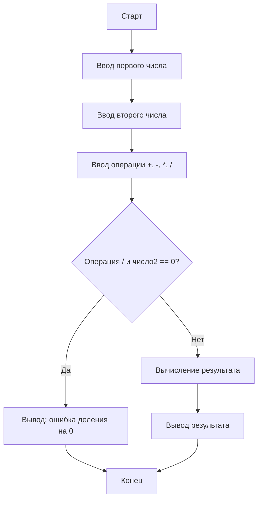

## Алгоритм работы

Ниже представлена блок-схема основной логики калькулятора:



# Калькулятор

Консольная программа-калькулятор на Python 3.

## Возможности

- Сложение, вычитание, умножение, деление
- Работа с целыми и дробными числами
- Обработка ошибок ввода
- Обработка деления на ноль
- Проверка введённой операции
- Возведение в степень: **

## Требования

- Python 3.10+
- ОС РЕД ОС (или другой Linux)

## Установка и запуск

1. Скопируйте папку проекта и перейдите в неё:

   ```bash
   cd ~/projects/calculator
   ```

2. Создайте виртуальное окружение, если оно ещё не создано:

   ```bash
   python3 -m venv venv
   ```

3. Активируйте окружение:

   ```bash
   source venv/bin/activate
   ```

4. Запустите программу:

   ```bash
   python main.py
   ```

5. Введите два числа, затем операцию: +, -, /, * или **.

Дробные числа вводятся через точку, например: 2.5.

Для нового вычисления запустите программу повторно.

## Пример работы

```text
Калькулятор
Введите первое число: 10
Введите второе число: 2
Введите операцию (+, -, *, /, **): /
Результат: 5.0
```

## Автор

Дмитрий Терещук, группа ПРЗ-23, 2026
