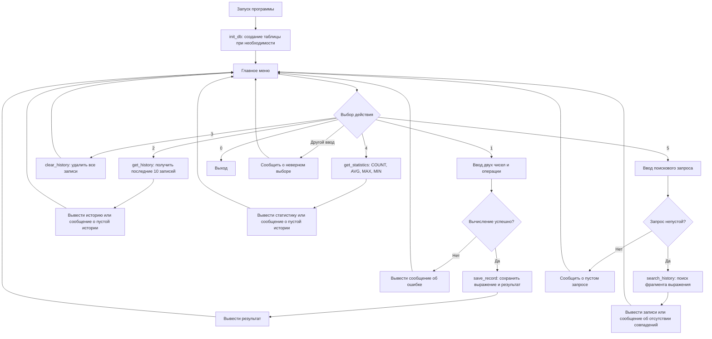

## Калькулятор с историей вычислений

Консольная программа на Python 3.
История вычислений хранится в базе данных SQLite.

## Возможности

- Сложение, вычитание, умножение и деление
- Работа с целыми и дробными числами
- Обработка некорректного ввода и деления на ноль
- Сохранение успешных вычислений в SQLite
- Просмотр последних 10 записей истории
- Очистка истории
- Просмотр статистики: количество, средний, максимальный и минимальный результаты
- Поиск записей по фрагменту выражения

## Требования

- Python 3.10+
- ОС РЕД ОС или другой Linux
- Дополнительные библиотеки не требуются: sqlite3 входит в стандартную библиотеку Python

## Структура проекта

- main.py — меню и взаимодействие с пользователем
- calc_logic.py — математические функции
- db_manager.py — работа с базой данных
- README.md — описание проекта
- .gitignore — правила исключения файлов из Git

Файл history.db создаётся автоматически при запуске программы.
Локальную базу данных и виртуальное окружение не следует добавлять в Git.

## Установка и запуск

1. Перейдите в папку проекта:

   ```bash
   cd ~/projects/calculator
   ```

2. Создайте виртуальное окружение, если его ещё нет:

   ```bash
   python3 -m venv venv
   ```

3. Активируйте окружение:

   ```bash
   source venv/bin/activate
   ```

4. Запустите программу:

   ```bash
   python main.py
   ```

## Меню

- 1 — выполнить вычисление
- 2 — показать последние 10 записей
- 3 — очистить историю
- 4 — показать статистику
- 5 — найти записи в истории
- 0 — выйти

Для вычисления введите два числа, затем операцию: +, -, * или /.
Дробные числа вводятся через точку, например 2.5.
После выполнения действия программа возвращается в меню.

## Статистика

Функция get_statistics() возвращает словарь:

- count — общее количество вычислений
- average — средний результат
- maximum — максимальный результат
- minimum — минимальный результат

Для пустой истории count равен 0, остальные значения равны None.
В меню при этом выводится сообщение об отсутствии статистики.

## Поиск по истории

Функция search_history(keyword) ищет указанный текст в выражениях.
Результаты выводятся от новых записей к старым.

Например, запрос 5 найдёт выражения 5.0 + 2.0 и 15.0 / 3.0.
Поиск выполняется по фрагменту текста, а не по отдельному числу.
Если совпадений нет, программа сообщает об этом.

## Схема работы с базой данных



## Автор

Дмитрий Терещук, группа ПРЗ-23, 2026
